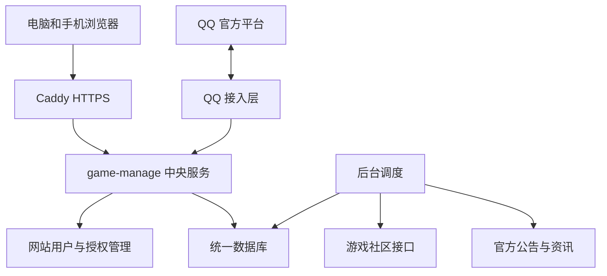

# game-manage 云端服务与 QQ 多设备看板需求设计

日期：2026-10-12（Asia/Shanghai）

状态：总体方案已获用户认可；本文为归档设计基线，新增官方接入细节尚未实测。仅完成调研与文档，不代表已实现或已部署。

## 1. 目标与状态口径

将 game-manage 改造为面向朋友小群的中央服务，统一保存各人的游戏授权与数据，通过网页和 QQ 两个入口查询。复用现有 LOLhelper 服务器，优先接入 QQ 官方机器人。

| 状态 | 含义 |
| --- | --- |
| 已确认需求 | 用户明确提出或认可的范围与方向 |
| 已核实事实 | 本轮会话通过源码、服务器只读检查或官方文档确认；注明时间与边界 |
| 设计基线 | 基于已认可方案整理的实现约束；不表示功能已实现 |
| 待验证 | 必须通过真实账号、目标服务器或平台实际权限检查才能确定 |
| 待决定 | 仍需要选择的具体配置，不阻碍当前文档归档 |

官方文档说明平台具备某项能力，不等于本项目的机器人已经获权。服务器资源快照不等于容量测试。

## 2. 已确认需求与范围

| 编号 | 已确认内容 |
| --- | --- |
| R01 | 面向 5–20 人朋友小群，大家使用国服；首期按官服设计，是否存在 B服或其他渠道服尚不确定 |
| R02 | 每人绑定自己的游戏账号，只查询和管理自己的私人数据 |
| R03 | 将现有鸣潮、异环、终末地账号绑定和查询能力接入 QQ，保留各游戏实际能力差异 |
| R04 | 包含活动日历、公告与资讯；参考爱弥斯、WutheringWavesUID、NTEUID 的指令及展示形式 |
| R05 | 优先 QQ 官方机器人；目前没有机器人应用、接入程序或部署实例 |
| R06 | 游戏授权集中保存在服务器，网页和 QQ 使用同一套账号数据 |
| R07 | 其他电脑、手机只需登录看板账号，不需逐设备重新登录游戏社区；支持手机流量访问 |
| R08 | 复用此前 LOLhelper 云服务器，目标全天运行；单机方案不承诺无中断高可用 |
| R09 | 当前仅调研、需求和设计归档，不写产品代码、不部署；QQ 官方规则由助手查询 |
| R10 | 需求、总体设计、QQ 官方接入核查合并保存为这一份文档 |

首期采用邀请制、每人每游戏一个默认账号、网页授权、QQ 被动查询；先文字后图片卡片。底层保留多授权、多角色的建模空间。

2026-10-12 实施补充确认：看板域名使用 `game.rekibot.cloud`；用户确认主域名 `rekibot.cloud` 已备案，此处为用户确认信息，未独立查询备案登记。DNS、HTTPS 实際访问及 QQ 消息 URL 白名单仍待部署验证；现有 `sync.rekibot.cloud` 服务保持独立。

首期不包含渠道服新增适配、国际服、自动签到、游戏操作、复杂群管理、娱乐功能、完整机器人插件复刻、跨用户查询和群排行榜。主动订阅推送列为后续选项。不会因迁移而把缺失数据或不完整抽卡历史声明为已具备。

## 3. 已核实的项目与服务器基础

### 3.1 当前代码

实际源码目录为 `C:/Zcode/game-manage`，文档整理时分支为 `main`、HEAD 为 `c78cc32`。聊天工作目录中的历史报告和备份不作为当前实现依据。

| 事实 | 本地依据 | 设计影响 |
| --- | --- | --- |
| Python / FastAPI / SQLite 后端与 Vue 看板；目前支持边界为本机单用户 | [README](../../../README.md)、[SECURITY](../../../SECURITY.md) | 不能直接将当前端口暴露到公网 |
| 登录服务以每游戏一个账号组织 | [auth/service.py](../../../src/game_assistant/auth/service.py) | 必须增加网站用户和独立授权账号维度 |
| 主快照与轮询状态以 game_id、capability 为主键 | [snapshots.py](../../../src/game_assistant/snapshots.py) | 必须改造私人快照、任务与缓存隔离 |
| Host / Origin 校验属于本机访问边界，不是网站用户授权 | [api_security.py](../../../src/game_assistant/api_security.py) | 增加会话鉴权与对象归属校验，不能仅放宽 Host |
| Windows 凭据采用 DPAPI；其他平台已有 AES-GCM 分支 | [auth/store.py](../../../src/game_assistant/auth/store.py) | 非 Windows 存储代码存在，但 Linux 完整部署未验证 |
| 终末地寻访和森空岛档案使用独立授权；私人接口仍有真实账号验证缺口 | [终末地工具箱](../../endfield-toolbox.md) | 保留独立身份，不自动拼接两个角色的数据 |

现有适配器、数据解析、失败保留逻辑、资讯日历和前端可以复用；用户体系、多人授权、权限检查、QQ 接入及云端运维是新增工作。全量私人数据审计须覆盖抽卡账本、历史记录、收藏、蓝图、导入导出、图片缓存及森空岛服务，不只修改主快照表。

### 3.2 服务器快照

2026-10-12 在本次会话中通过 SSH 只读核实；不在文档中保存公网地址、SSH 身份或密钥路径。

| 项目 | 实测状态 |
| --- | --- |
| 系统 | Ubuntu 24.04.4 LTS，x86_64 |
| CPU | 2 个逻辑 CPU |
| 内存 | 总计约 1967 MiB，可用约 1314 MiB；约 2GB Swap |
| 根磁盘 | 50GB，总剩余约 40GB |
| 现有服务 | pigeon-dashboard、pigeon-sync、Caddy 均 active |
| 服务内存 | 两个 LOLhelper 服务合计约 189 MiB；仅为当时快照 |
| 部署工具 | 已有 systemd 和 Caddy，未安装 Docker |

设计判断：可作为小群试运行起点。游戏接口云端可达性、2GB 内存下的图片渲染峰值、长期刷新与 LOLhelper 共存影响均待测，不能据此承诺无需扩容。

## 4. 架构与选型

### 4.1 方案取舍

| 方案 | 评价 |
| --- | --- |
| game-manage 中央服务加 QQ 接入层 | 采用；统一授权与数据，保留已有看板和适配能力 |
| gsuid_core 与插件为中心，再接网页 | 机器人基础丰富，但需重新整合现有功能与数据模型，本期不采用 |
| 两套程序分别维护授权再同步 | 会增加重复登录、缓存分歧和故障排查成本，不符合目标 |

### 4.2 组件

- 中央服务负责用户认证、对象权限、游戏授权、数据查询和刷新编排。
- QQ 接入层负责平台鉴权、消息身份、指令解析、结果展示及发送；不保存第二份游戏授权，不直连数据库。
- 公共资讯按来源统一采集，所有用户共享；私人数据始终按账号隔离。
- 单机模块化部署；首期可在中央服务内运行唯一调度器，不以多 API worker 重复启动轮询。需要拆分时再独立 worker。
- LOLhelper 继续独立运行，数据库、系统用户和服务端口不与 game-manage 混用。

首期使用 SQLite 本机文件、短事务和受控写入；QQ 只调用内部 API。出现持续写锁竞争或多实例需求后评估 PostgreSQL，不预设 Redis、消息中间件或 Kubernetes。

## 5. 身份与游戏授权

### 5.1 三层身份

| 对象 | 用途与约束 |
| --- | --- |
| 网站用户 | 邀请注册，独立登录；普通用户只能访问本人对象 |
| QQ 身份 | 将经平台验证的发送者关联到网站用户；不可用昵称或用户输入的 QQ 号代替 |
| 游戏授权与角色 | 保存社区授权、渠道、服务器及角色；一个授权可对应多个可选角色 |

QQ 关联保留 AppID、场景、群上下文和平台 OpenID。群聊使用 member_openid，单聊使用 user_openid；在没有明确依据和验证前，不认定两者相等，也不自动跨群合并。用户可以分别完成关联，最终指向同一网站用户。union 字段可能为空，不能作为首期唯一依赖。

### 5.2 用户流程

1. 接受邀请码，建立网站账号并登录。
2. 在网站完成游戏社区授权，人机验证与短信验证码由本人操作；选择默认角色。
3. 网站生成仅用于 QQ 关联的短时单次码，用户向机器人提交。
4. 中央服务记录待关联的 QQ 身份，网站显示本次尝试，由已登录用户确认；确认前不能查询私人数据。
5. QQ 查询按已关联身份找到默认账号，与网页读取同一快照。
6. 换设备只登录网站；授权过期时在任一设备重新授权一次，网页和 QQ 一并恢复。

关联码不可换取网站会话或游戏凭据；限制次数、存储摘要、确认时原子消费。转发、抢占、重复使用、跨用户确认必须拒绝；撤销关联立即生效。具体有效期属于实现参数。

终末地的鹰角寻访授权和森空岛档案授权分别连接、分别显示角色身份；只有身份核对一致时才可汇总，不能凭昵称认定同一角色。

### 5.3 权限与隐私

- 后端每次访问校验用户与对象归属；身份从可信会话或经认证的 QQ 接入层取得，不信任请求中的任意 user_id。
- QQ 接入层使用专用服务凭据，只调用限定内部接口；普通网页不能伪造 QQ 发送者上下文。
- 管理员管理邀请、服务状态和故障信息，界面不提供读取他人游戏凭据的能力。服务器运维者仍处于可信边界内，不宣称能防止主机管理员访问运行时数据。
- 群聊查询的结果会被全群看到，只返回本人主动请求的摘要，隐藏完整 UID 等非必要字段。首期禁止查询他人。
- 授权加密保存，密钥单独保管；日志、导出与错误响应不得包含 token、验证码、Cookie 或完整登录响应。

## 6. 数据与刷新

| 数据对象 | 设计约束 |
| --- | --- |
| 用户、会话、邀请 | 支持撤销设备会话；密码采用成熟密码散列方案 |
| QQ 关联与待确认请求 | 独立于游戏授权；保存平台作用域；唯一约束防止重复归属 |
| 社区授权 | 归属用户，按 provider 独立加密；记录授权版本和状态 |
| 游戏账号与角色 | 绑定授权、game、channel、server、role，明确默认选择 |
| 私人快照及刷新状态 | 使用账号、角色、capability 等完整键，记录最后成功和失败状态 |
| 历史账本、收藏与导出 | 按所属账号隔离，导入预览后写入目标账号 |
| 公告与日历 | 公共数据，保留原文链接、来源、时间与解析依据 |
| 查询卡片与媒体缓存 | 包含账号及快照版本，防止跨用户命中；有清理期限 |

刷新基线为缓存优先、后台更新。私人概览初值 10–15 分钟，公共资讯初值约 10 分钟，角色详情按需获取；均为待调优值，不是上游保证或已验证配额。

同一账号请求合并，按用户、游戏来源限流并错峰。令牌刷新按授权加锁；请求带授权版本，退出或切换账号后的旧结果不得回写。未知数据保留 null，刷新失败保留旧快照并标明陈旧、授权过期或上游错误。

活动日期保留原始时区并统一以 Asia/Shanghai 展示；相对日期或未知截止时间不推算成确定日期。抽卡历史完整性、缺段与统计窗口必须可见。

## 7. QQ 官方接入核查

核查日为 2026-10-12。以下来自 QQ 官方网站正文；尚未创建机器人、登录开发者后台或发起真实消息测试。官方旧 GitHub 文档镜像与当前网站存在差异，以当前网站为本轮设计依据。

### 7.1 主体与发布条件

官网现列个人与企业均支持群聊、单聊和频道；沙箱群须由开发者担任群主或管理员，成员不超过 20 人。正式使用需自测、审核并上线；可以设群白名单。新机器人需配置公网 IP 白名单。消息中的网页域名需 ICP 备案、校验并报备。依据：[官方接入指南，开发场景、开发设置及发布章节](https://bot.q.qq.com/wiki/)。

项目影响：可以从个人主体尝试；5–20 名使用者不等于目标群成员数合规，须核对整个沙箱群。域名、备案及目标账号的实际权限尚未核实。无需用户逐页截图；账号注册、实名和人工验证由用户操作，助手依据官方规则协助后续核查。

### 7.2 消息能力和设计约束

| 官方事实 | 对本项目的约束 | 来源 |
| --- | --- | --- |
| 使用 AppID、AppSecret 获取访问凭证，旧 Token 鉴权已弃用 | 密钥仅在服务端保存，统一管理 access_token 生命周期 | [启动接入](https://bot.q.qq.com/wiki/develop/api-v2/) |
| 当前 API 地址为 api.bot.qq.com；2026-08-10 变更记录明确域名统一 | 不照搬旧首页示例中的 sgroup 域名；沙箱调用方式在联调时核实 | [API 指南](https://bot.q.qq.com/wiki/develop/api-v2/dev-prepare/api-call-guide.html)、[变更记录](https://bot.q.qq.com/wiki/develop/api-v2/changelog.html) |
| GROUP_AT_MESSAGE_CREATE 携带 member_openid 和 group_openid | 首期使用 @机器人加指令；发送者由事件取得 | [群 @ 事件](https://bot.q.qq.com/wiki/develop/api-v2/autogen/event/group_at_message_create.html) |
| 开启接收所有消息后可产生 GROUP_MESSAGE_CREATE | 无需 @ 属于可选能力；本应用开通状态待验证，不作为首期条件 | [群全量消息](https://bot.q.qq.com/wiki/develop/api-v2/autogen/event/group_message_create.html) |
| OpenID 与 AppID 及场景有关 | 不把 OpenID 当 QQ 号，不自动跨场景合并身份 | [唯一身份机制](https://bot.q.qq.com/wiki/develop/api-v2/dev-prepare/api-call-guide.html#唯一身份机制) |
| 群被动回复窗口 5 分钟、每条消息最多回复 5 次 | 快速返回缓存；任务超时后引导再次查询，不无限等待再补发 | [消息收发概述](https://bot.q.qq.com/wiki/develop/api-v2/server-inter/message/overview.html) |
| 支持文本、Markdown 和富媒体；媒体上传后获取 file_info，具有有效期 | 先文字，后轻量图片；上传及可用权限需实测 | [消息收发概述](https://bot.q.qq.com/wiki/develop/api-v2/server-inter/message/overview.html) |
| 主动消息有频控且可被接收方关闭，发送接口也可能拒绝权限 | 平台有能力不等于本应用可用；订阅推送后续独立验收 | [消息收发概述](https://bot.q.qq.com/wiki/develop/api-v2/server-inter/message/overview.html)、[发送群消息](https://bot.q.qq.com/wiki/develop/api-v2/autogen/api/v2_groups_group_openid_messages.post.html) |
| 重复 msg_id 可能重投；发送使用 msg_id 与 msg_seq | 入站去重，出站记录回复序号，超时重试不产生重复业务操作 | [发送群消息](https://bot.q.qq.com/wiki/develop/api-v2/autogen/api/v2_groups_group_openid_messages.post.html) |
| 官网当前同时列有 Webhook 和 WebSocket 接入 | 接入层隔离传输协议；暂选 WebSocket，账号与 SDK 验证后定版 | [WebSocket](https://bot.q.qq.com/wiki/develop/api-v2/dev-prepare/event-emit/websocket.html)及页面 Webhook 导航 |

WebSocket 暂选方案由服务主动连接网关，处理心跳、断线重连和会话恢复；不额外要求事件入站端口。如果实际条件要求 Webhook，改由 Caddy 转发独立回调端点，按官方协议校验签名及事件、去重并快速响应。两者不会改变游戏服务接口。

### 7.3 公网链接的影响

网站可访问、机器人可下发网址是两项不同验收。HTTPS 本身不能替代 QQ 消息 URL 报备；报备也不应被当成所有消息格式都能发送成功的保证。

首期 QQ 文本查询不能依赖链接可用才能工作。未通过报备时，机器人不发送看板 URL；用户通过预先保存的网站入口访问。公告消息仅返回摘要，原始来源链接在网页内保留。不得以短链、二维码或跳转域名绕过平台限制。

### 7.4 指令与展示基线

群聊基础形式为 `@机器人 指令`；命令名称可以同时提供中文和 ww、yh 前缀别名。

| 指令 | 行为 |
| --- | --- |
| 帮助 | 支持范围、绑定步骤及可用指令 |
| 绑定 <关联码> | 提交 QQ 身份关联，等待已登录网页确认 |
| 我的账号 | 本人默认角色、授权状态；不展示凭据 |
| ww 查询／yh 查询／终末地 查询 | 本人概览、快照时间与状态 |
| ww 角色 <名称> | 现有能力支持的角色详情 |
| 日历／ww 活动 | 近期活动与确定的截止时间 |
| ww 公告／yh 资讯 | 标题和摘要；链接仅在报备和发送测试通过后提供 |
| 刷新 | 合并或提交后台任务，立即反馈；窗口外由用户再次查询 |
| 看板 | 条件满足时返回正常网站入口，不附带免登录私人数据令牌 |

文字结果优先；后续图片使用独立模板、限制尺寸和并发，显示数据时间。Markdown、按钮、媒体转存失败均可降级为文字。正常查询设计目标为缓存命中时数秒内回复，具体延迟通过联调与负载测试确定。

## 8. 云端部署与迁移

采用 Caddy、systemd、独立 Python 虚拟环境和预构建前端，暂不为本项目引入 Docker。前端在本地或 CI 构建，云端只运行产物。服务端口仅监听回环地址；网站经 HTTPS 公开，内部 API 另有鉴权。

| 项目 | 设计基线 |
| --- | --- |
| 服务隔离 | 独立系统用户、目录、端口和日志；不修改 LOLhelper 数据 |
| 网站身份 | 邀请制、成熟密码散列、Secure/HttpOnly 会话 Cookie、CSRF 防护、登录限流、会话撤销 |
| 资源控制 | 唯一调度器、有限上游并发、图片渲染低并发；限制日志和缓存增长 |
| 故障恢复 | 开机自启、失败重启、网络超时、退避重试、健康状态与错误计数 |
| 备份 | 每日一致性数据库备份，密钥独立受控备份；保留期和备份目的地待决定 |
| 观测 | 内存、磁盘、刷新成功率、授权失效、QQ 连接和发送失败率 |

迁移步骤：备份本地数据；为原有私人数据指定用户与账号归属；预演结构迁移并核对记录数；部署隔离测试实例；在云端重新完成游戏授权；验证后切换访问入口。Windows DPAPI 文件不直接作为 Linux 可用凭据。迁移不得清空或覆盖来源不明确的数据，无法归属的记录列入人工核对。

上线前准备数据库恢复与版本回退方案。旧程序不能直接写入新结构数据库；回退应使用匹配的程序版本与备份，并说明切换后新增数据的处理方式。

## 9. 待验证清单

| 编号 | 待验证内容 | 通过依据 | 影响 |
| --- | --- | --- | --- |
| V01 | 个人主体机器人实际群权限、目标群添加、沙箱与正式环境 | 控制台可配置并完成真实群收发 | QQ 首期前置 |
| V02 | 域名、备案、URL 报备与实际消息发送 | 合法可用域名通过平台校验，目标群收到可访问链接 | 不阻塞纯文字查询，阻塞看板链接指令 |
| V03 | SDK 与事件传输、API 域名和沙箱模式 | 握手、鉴权、断线恢复、重复事件测试成功 | 接入层定版前置 |
| V04 | 三款游戏在该云出口授权、续期及查询 | 每款至少一个真实官服账号；登录态失效路径有证据 | 对应游戏上线前置 |
| V05 | 终末地鹰角与森空岛角色匹配和私人接口 | 两条授权分别成功，确认实际角色，失败不混合数据 | 终末地私人数据上线前置 |
| V06 | 双用户隔离、缓存、任务、导出与退出清理 | A 无法读取或改写 B；旧任务不回写新授权；图片不串号 | 公网开放前置 |
| V07 | Linux 依赖、加密密钥、数据迁移与恢复 | 干净部署、重启、迁移核对、备份还原成功 | 云端切换前置 |
| V08 | 手机流量访问、网页会话与社区授权复用 | 至少两设备跨网络登录，游戏社区无需分别授权 | 多设备功能验收 |
| V09 | 5–20 人负载、图片峰值与 LOLhelper 共存 | 模拟目标负载及持续运行，无 OOM，记录延迟和资源余量 | 确定是否扩容 |
| V10 | 公共资讯云端采集与失败保留 | 真实来源可取，异常不覆盖旧数据，来源和日期可追溯 | 日历资讯验收 |
| V11 | 无需 @、Markdown、按钮及主动推送实际权限 | 控制台状态与成功响应双重证据 | 可选功能，不阻塞基础查询 |

待决定项：最终 SDK 验收、备份目的地和保留周期、具体刷新间隔及资源阈值。网站域名已确定为 `game.rekibot.cloud`，用户确认主域名已备案；接入状态与消息 URL 报备仍按 V02 核验。用户恢复方式按实施计划采用管理员签发单次恢复码。渠道服用户是否存在仍待用户后续确认；当前按官服范围执行设计。

## 10. 分阶段交付与验收

| 阶段 | 交付 | 验收门槛 |
| --- | --- | --- |
| 0 设计归档 | 本文与官方来源 | 已确认内容、实现边界、待验证项明确；不进入产品编码 |
| 1 关键可行性验证 | QQ 最小链路与云端游戏接口验证记录 | V01、V03、V04；终末地补 V05；失败按游戏或入口明确降级 |
| 2 中央服务多人化 | 用户体系、授权与数据隔离、迁移方案 | V06、V07；未通过前不得面向朋友公开 |
| 3 多设备网页 | HTTPS、手机布局和可撤销会话 | V08，公共来源 V10 |
| 4 QQ 查询 | 关联、指令、文字回复与失败处理 | QQ 与网页同源；重复事件不重复执行；超时不越权补发 |
| 5 稳定运行与图片 | 运维、恢复、资源限制、图片降级 | V09；图片权限可用；重启和恢复有证据 |

单机全天运行表示不依赖用户电脑开机，并能自动恢复常见进程或网络故障；不保证服务器故障或上游不可用时仍有实时数据。QQ 不可用时网页仍应可用，某款游戏故障不能阻塞其他游戏和公共内容。

下一步先审阅本归档，再另行形成实施计划；本次整体方案认可和文档保存不等于授权实施、购买资源或提交平台审核。

## 11. 参考项目与证据边界

- [爱弥斯](https://www.kokos.icu/)：指令和入口组织参考，其无需 @ 体验不证明本应用权限。
- [NTEUID](https://github.com/tyql688/NTEUID)：异环机器人能力参考；项目列有模板及渲染资源使用限制，不直接复制其视觉资源。
- [WutheringWavesUID 维护分支](https://github.com/MoonShadow1976/WutheringWavesUID)：鸣潮交互参考；部分能力依赖额外服务，不以插件功能表承诺本项目全部实现。
- 当前仓库源文件用于判断已实现结构；本会话服务器只读结果用于记录运行环境；QQ 官方网站用于接入条件。三者不能替代真实多人隔离、云端授权和平台收发测试。

官方规则可能更新；未来实施时复核本文第 7 节链接与应用控制台，不使用旧镜像中的“个人不能接群”结论，也不把旧消息路径重定向后的首页当成具体接口说明。
